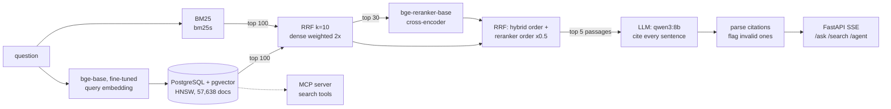

# Financial RAG QA

[](https://github.com/AnuragBhandary/Financial-RAG-QA/actions/workflows/ci.yml)


Retrieval-augmented question answering over **FiQA-2018**: 57,638 answers from a
personal-finance Q&A forum, with **648 held-out questions** that people labelled for relevance.
Every answer sentence cites its passage, and every claim the system makes about itself is
measured: retrieval against the human labels (with confidence intervals and paired significance
tests), answer faithfulness with an LLM judge, and the judge itself against hand labels.

The measurement changed the design. The textbook pipeline (BM25 + embeddings + an off-the-shelf
cross-encoder) was **worse** than embeddings alone on this data; what worked was tuning fusion on
the dev split, fine-tuning the embedding model on FiQA's training questions, and fusing the
reranker's order with the retriever's instead of replacing it.

**Stack:** Python · PostgreSQL 17 + pgvector (HNSW) · bm25s · sentence-transformers (bge-base,
bge-reranker) · PyTorch (fine-tuning on Apple GPU) · Ollama (qwen3) or Groq · LangGraph · FastAPI
(SSE) · MCP · Docker Compose · GitHub Actions

### Measured results ([details](docs/RESULTS.md))

| 648 test questions | nDCG@10 | |
|---|---|---|
| BM25 | 0.253 | baseline |
| Dense, off-the-shelf bge-base | 0.406 | |
| Hybrid → off-the-shelf reranker alone | 0.365 | **−14%**: the reranker hurt |
| **Fine-tuned embedder + tuned hybrid + fused rerank** | **0.435** | **+72%** vs BM25, **+7%** vs off-the-shelf dense (p < 0.001) |

| | |
|---|---|
| HNSW (ef_search=100) vs exact scan | 99.65% of the exact top 10, 1.7 ms vs 60.7 ms |
| Retrieval latency, hybrid + rerank | p50 85 ms, p95 95 ms |
| Ingest 57,638 docs (embed + COPY + HNSW) | 2.9 min on a laptop |

| 150 test questions, qwen3:8b, judged by qwen3:14b | Sentences supported by their citations |
|---|---|
| Single-shot, BM25 retrieval | 69.1% |
| **Single-shot, final retriever** | **80.2%** (p < 0.001 vs BM25), first token p95 2.3 s |
| **Agent** (rewrite, grade, self-check) | **93.4%**, at 4× the LLM calls and 12.5 s p50 |

The agent's gain comes from its self-check dropping unsupported sentences, not from finding
better evidence; the judge's own accuracy is measured against hand labels in
[RESULTS.md §6](docs/RESULTS.md#6-is-the-judge-right-hand-labels).

## Architecture



- **One Postgres table** holds the text, a generated `tsvector`, and the 768-d embedding with an
  HNSW index; the whole index is swapped in one transaction.
- **Agent mode** (LangGraph): plan searches → retrieve → grade evidence → (follow-up search) →
  answer → self-check that drops unsupported sentences.
- **Evaluation harness**: nDCG@10 / MRR@10 / recall@k per variant, bootstrap CIs, paired
  randomization tests, TREC run files, dev-only tuning, HNSW-vs-exact recall, latency.
- **Faithfulness**: sentence-level verdicts from qwen3:14b (a different model from the
  generator), checked against hand labels with Cohen's kappa.

Why each piece is the way it is: **[docs/DESIGN.md](docs/DESIGN.md)**.
How to study and defend it: **[docs/INTERVIEW.md](docs/INTERVIEW.md)**.

## Quick start

Needs Docker, [uv](https://docs.astral.sh/uv/) and, for answers, [Ollama](https://ollama.com).

```bash
make install data infra        # deps, FiQA (~18 MB), Postgres + pgvector on :5436
uv run finrag train-embedder   # optional, 22 min on an Apple-silicon GPU; else the base model
make ingest                    # embed + load + HNSW, ~3 min
ollama pull qwen3:8b
make serve                     # http://127.0.0.1:8000 (demo page) and /docs
```

```bash
uv run finrag ask "Is it better to pay off my mortgage early or invest?"
uv run finrag ask --agent "Can I deduct home office rent as an employee?"
curl -N -X POST localhost:8000/ask -H 'content-type: application/json' \
     -d '{"question": "How are ETF dividends taxed?"}'
```

The MCP server (`uv run finrag mcp`, stdio) exposes `search_finance_qa` and `get_document`
to any MCP client.

## Commands

| Command | What it does |
|---|---|
| `finrag ingest` | Embed (cached), load pgvector, build HNSW + GIN, build BM25 |
| `finrag tune` | Fusion grid + reranker depth/fusion grid, **dev split only** |
| `finrag eval-retrieval --split test` | Every variant, CIs, paired tests, TREC runs |
| `finrag hnsw`, `finrag bench` | ANN recall vs exact; single-query latency |
| `finrag train-embedder`, `train-reranker` | Fine-tune on FiQA train with mined hard negatives |
| `finrag answers --system rag:hybrid+rerank` / `agent` | Answers for 150 seeded test questions |
| `finrag judge` | LLM judge → faithfulness summary |
| `finrag label-sample`, `label`, `agreement` | Hand-label judge verdicts, measure agreement |
| `finrag serve`, `finrag mcp` | API + demo page; MCP server |

## Tests

```bash
make check     # ruff, mypy --strict, 60+ tests (unit + integration against real pgvector)
```

Unit tests use a hashing embedder, an overlap reranker and a scripted LLM, so CI needs no model
downloads. Integration tests run against the real pgvector container: atomic reloads, HNSW vs
exact, OR-ed full-text search, every retrieval mode, the agent graph, SSE streaming, error
events, and an MCP client session.

## Data and licence

FiQA-2018 via [BEIR](https://github.com/beir-cellar/beir) (Maia et al., 2018). Code: MIT.
